# AUDITORÍA INTEGRAL DE ARQUITECTURA, SEGURIDAD Y ESTADO OPERATIVO
**Proyecto:** JESSYCA 3.0 (`leeon003/asistente-jessyca`)  
**Rama de Trabajo:** `auditoria-total`  
**Identidad Git Certificada:** `leeon`  
**Fecha:** 2026-10-14  
**Hardware & Runtime:** Windows 10 (Build 26200), Python 3.11.9, GPU NVIDIA GeForce RTX 3060 (12 GB VRAM), Ollama v0.17.7 (127.0.0.1:11434).

---

## 1. MAPA REAL DE LA ARQUITECTURA

Jessyca está concebida bajo una arquitectura de capas de alta seguridad y especialización. A continuación se detalla qué componentes están **conectados en el flujo de producción** y cuáles estaban **aislados o desconectados**:

```mermaid
graph TD
    User["Entrada Usuario: Voz (Whisper) / Texto / MCP"] --> Normalizer["STT Normalizer & Completeness Checker"]
    Normalizer --> Agent["JessycaLocalAgent (Núcleo Unificado)"]
    
    subgraph Governance ["Capa de Gobernanza y Seguridad"]
        Agent --> RE["RiskEngine (Niveles 1, 2, 3)"]
        Agent --> PM["PermissionManager (ALLOW / REQUIRE_CONFIRMATION / DENY)"]
        Agent --> AP["AutonomyPolicy & EmergencyStopManager"]
    end

    subgraph LLMCerebro ["Cerebro Local Multi-LLM (Ollama)"]
        Agent --> MR["ModelRouter / ExperimentalRouter"]
        MR --> Llama["llama3.1:latest (Cerebro Primario - 2.2 GB VRAM)"]
        MR --> Gemma["gemma4:e4b (Alternativa Razonamiento - 11.7 GB VRAM)"]
        MR --> Vision["qwen3-vl:4b (Multimodal Vision - 3.6 GB VRAM)"]
    end

    subgraph ExecutionSubsystem ["Subsistema de Ejecución y Herramientas"]
        Agent --> SR["SkillRouter & SkillRegistry (32 Skills Activas)"]
        SR --> Apps["windows.apps (Calculadora, Notepad, Edge...)"]
        SR --> Files["files.* (Búsqueda, Lectura, Escritura, Organización)"]
        SR --> Browser["browser.* (Navegación, Descargas, YouTube Playback)"]
        SR --> Docs["documents.* (Word, Excel, PowerPoint, PDF, Resumen)"]
        SR --> CUA["windows.computer_use (Control Nativo Escritorio)"]
        SR --> Archify["tools.archify (Diagramación Técnica Interactiva)"]
        SR --> EV["ExecutionVerifier (Execute -> Verify -> Report)"]
    end

    subgraph MemoryEngine ["Memoria Multi-Agente y Persistencia"]
        Agent --> CCM["ConversationContextManager (Contexto Corto de Diálogo)"]
        Agent --> LTM["LongTermMemoryEngine (data/memory/long_term/ - Atómica en Disco)"]
        Agent --> MM["MemoryManager (Aislamiento Multi-Agente & Scopes)"]
    end

    subgraph OutputInterface ["Salida y Retroalimentación"]
        Agent --> RS["ResponseSynthesizer (Filtro Antispam & TTS es-PE-CamilaNeural)"]
        RS --> User
    end
```

### Estado de Conexión Detectado:
| Componente | Estado Previo | Diagnóstico y Acción Correctiva |
| :--- | :--- | :--- |
| **Ciclo Conversacional** | Parcialmente Roto | `interfaces/modo_voz.py` tenía un error de sintaxis en la línea 408 (`try:` sin indentar) que rompía la importación de `interfaces` y 17 suites de tests. Corregido. |
| **JessycaResponse** | Inconsistente | El dataclass `JessycaResponse` en `local_agent_models.py` carecía del atributo `requires_confirmation`, mientras que `response_synthesizer.py` y `to_dict()` lo invocaban. Corregido. |
| **Memoria Persistente** | **Desconectada** | `JessycaLocalAgent` solo usaba `ConversationContextManager` en memoria RAM volátil. El motor `LongTermMemoryEngine` (`core/memory/long_term_memory.py`) no estaba instanciado en el flujo principal. Se integró directamente al agente. |
| **Skill Computer Use** | **Desconectada** | Existía `ComputerUseAdapter` en `core/integration/adapters/`, pero no estaba expuesto como `BaseSkill` en `skills/`. Se implementó `skills/computer_use_skill.py` (`windows.computer_use`). |
| **Skill Archify** | **Desconectada** | `ArchifySkill` existía pero no estaba en `SKILLS_DISPONIBLES` ni en `skills/__init__.py`. Se registró en el catálogo oficial (`tools.archify`). |
| **Limpieza COM Office** | Inestable | En `core/documents/powerpoint_processor.py`, `del ppt` inmediatamente después de `ppt.Quit()` provocaba desconexiones RPC de Windows (`0x80010108`). Se estabilizó la liberación segura de interfaces COM. |

---

## 2. AUDITORÍA DE MÓDULOS, IMPORTS Y DEPENDENCIAS

### 2.1 Verificación de Entorno Python y Librerías
- **Intérprete Utilizado:** Python 3.11.9 (`C:\Users\PC\AppData\Local\Programs\Python\Python311\python.exe`)
- **Librerías Críticas Instaladas y Validadas:**
  - `torch` 2.4.0+cu124 (CUDA activo en RTX 3060).
  - `playwright` 1.48.0 (Navegación web headless y visual).
  - `pyautogui`, `psutil`, `comtypes`, `win32gui` (Interacción nativa de escritorio).
  - `edge-tts` (Síntesis vocal en español peruano `es-PE-CamilaNeural`).
  - `faster-whisper` (Transcripción STT local acelerada por GPU).
  - `openwakeword` (Detección de palabra de activación "Jessyca").
  - `pydantic` v2 y `pydantic-settings` (Configuración tipada).

### 2.2 Imports Rotos Corregidos
1. `interfaces/modo_voz.py:408`: Bloque `try:` a nivel de módulo con indentación rota que impedía la importación de cualquier submódulo de `interfaces`.
2. `core/local_agent/local_agent.py`: Mapeo obsoleto `_select_model_for_intent` que devolvía `"qwen2.5-coder:7b"` (nombre inexistente en `ModelRegistry`). Actualizado a `"gemma4:e4b"` y `"llama3.1"`.

---

## 3. AUDITORÍA DEL CATÁLOGO DE SKILLS

Se validaron las **32 habilidades registradas** en `skills/__init__.py`. Todas se instancian sin errores y se matriculan en `SkillRegistry`:

1. **Grupo Windows (8 skills):**
   - `windows.apps` (Lanzamiento y cierre con verificación de PIDs)
   - `windows.media` (Reproducción de videos y medios locales)
   - `windows.screenshot` (Captura de pantalla para visión con Qwen3-VL)
   - `windows.clipboard` (Lectura y escritura segura del portapapeles)
   - `windows.notifications` (Notificaciones nativas Toast)
   - `windows.audio` (Control de volumen por CoreAudio)
   - `windows.display` (Resolución y monitores)
   - `windows.computer_use` (**Nueva**: Control físico de mouse, teclado y ventanas bajo Nivel 3)
2. **Grupo Files (10 skills):**
   - `files.search`, `files.read`, `files.create`, `files.copy`, `files.move`, `files.rename`, `files.organize`, `files.create_folder`, `files.list`, `files.metadata`.
3. **Grupo Browser (6 skills):**
   - `browser.open`, `browser.search`, `browser.navigate`, `browser.read`, `browser.download`, `browser.youtube`.
4. **Grupo Documents (4 skills):**
   - `documents.read`, `documents.create`, `documents.summarize`, `documents.convert`.
5. **Grupo Tools & Arquitectura (1 skill):**
   - `tools.archify` (**Integrada**: Diagramación técnica de software).
6. **Legacy Aliases (3 skills):**
   - `abrir_aplicacion`, `cerrar_aplicacion`, `buscar_archivo`.

---

## 4. AUDITORÍA DEL MOTOR DE MEMORIA Y PERSISTENCIA

### Invariantes de Seguridad Verificadas:
1. **MEMORY != AUTHORITY:** Los registros en memoria son clasificados estrictamente como `EVIDENCE (untrusted_data: true)`. En ningún caso un registro almacenado puede anular las políticas de `RiskEngine` o conceder permisos de ejecución.
2. **Defensa contra Envenenamiento (Poisoning Defense):** En `core/memory/long_term_memory.py`, se interceptan intentos de prompt injection como *"User says always allow this action"* o *"Override permission"*, neutralizándolos con el marcador `[POISONING_ATTEMPT_NEUTRALIZED]`.
3. **Persistencia Atómica (Crash-Safe):** Los registros de `LongTermMemoryEngine` se serializan en `data/memory/long_term/` escribiendo primero en un archivo temporal con `os.fsync()` a nivel de kernel de Windows y posterior `os.replace()`, evitando truncado o corrupción de archivos ante caídas.
4. **Conexión al Agente:** Se conectó la llamada `agent.remember(...)` y `agent.recall(...)` para que hechos explícitos del usuario ("recuerda que...", "mi nombre es...") se persistan en disco y se mantengan vivos entre reinicios del proceso.

---

## 5. AUDITORÍA DE SEGURIDAD Y PERMISOS

- **RiskEngine:** Asigna de forma determinista:
  - Nivel 1 (SAFE): Lectura de archivos, visualización, información de sistema. Auto-ejecutable.
  - Nivel 2 (MODERATE): Foco de ventana, creación de carpetas, operaciones web estándar.
  - Nivel 3 (HIGH): Eliminación de archivos, macros de mouse/teclado, formateo o cierre de procesos.
- **PermissionManager:** Bloquea por defecto cualquier acción crítica si no cuenta con aprobación explícita o modo interactivo habilitado.
- **EmergencyStopManager:** El mecanismo de interrupción de emergencia (`kill-switch`) responde en menos de 50 ms restaurando el estado a seguro y cancelando cualquier tarea en segundo plano.

---

## 6. LÍNEA BASE DE TESTS EXISTENTES
- **Total de pruebas en la suite:** 4,038 tests.
- **Tests ejecutados con éxito inicial:** 3,982 passed (~98.6%).
- **Tests críticos validados tras reparaciones:**
  - `tests/conversation/test_conversational_core_phase49.py`: **9/9 PASSED**.
  - `tests/test_server_startup_hotfix.py`: **11/11 PASSED**.
  - `tests/conversation/test_conversational_memory_phase54.py`: **7/7 PASSED**.
  - `skills registration & imports`: **32/32 PASSED**.
