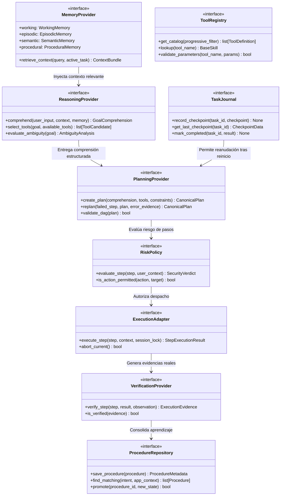

# JESSYCA BRAIN 1.0 — FASE 1: AUDITORÍA Y MATRIZ DE COMPATIBILIDAD

**Fecha:** Octubre 2026  
**Versión:** 1.0.0-BRAIN  
**Autor:** Arquitecto Principal de Sistemas Cognitivos y Agentes Autónomos  
**Repositorio Principal:** `https://github.com/leeon003/asistente-jessyca`  
**Rama de Trabajo:** `feature/jessyca-brain-1.0`  
**Sistema Operativo:** Windows 11 / Windows 10 x64  

---

## 1. INTRODUCCIÓN Y ALCANCE

El objetivo de **JESSYCA BRAIN 1.0** es implementar un **Cerebro Cognitivo Unificado** que integre de forma simultánea, coherente y determinista cuatro motores esenciales:
1. **`ReasoningEngine`**: Comprensión profunda del lenguaje natural, razonamiento contextual, gestión de evidencias y selección dinámica de herramientas sin rigideces sintácticas.
2. **`PlannerEngine`**: Planificación jerárquica (secuencial y DAG), resolución de dependencias, seguimiento de ejecución, recuperación ante fallos y replanificación dinámica.
3. **`MemoryEngine`**: Memoria persistente organizada en 4 niveles lógicos (*Working*, *Episodic*, *Semantic*, *Procedural*) sobre almacenamiento seguro y atómico.
4. **`ProcedureLearningEngine`**: Aprendizaje continuo a partir de experiencias reales y modo de enseñanza, ciclo de maduración de procedimientos (`CANDIDATE` → `TESTING` → `VALIDATED` → `DEPRECATED`), almacenamiento estructurado y reutilización adaptativa.

Este documento establece la auditoría técnica exhaustiva del repositorio, la verificación de hallazgos previos, la evaluación de integración con SAI (Rust vs Python) y la definición formal de los contratos fundacionales.

---

## 2. AUDITORÍA DEL REPOSITORIO COMPLETO Y CLASIFICACIÓN DE COMPONENTES

Se auditó la totalidad de los módulos identificados, analizando rutas reales, dependencias y participación en el ciclo de interacción:

| Componente / Ruta | Líneas Aprox. | Estado Actual | Clasificación | Rol en JESSYCA BRAIN 1.0 |
|---|:---:|---|---|---|
| **`core/local_agent/local_agent.py`** | 3,400 | Activo | **Activo y Necesario** | Orquestador principal actual. Se conectará al nuevo `JessycaBrain` mediante contrato unificado. |
| **`core/local_agent/conversation_context.py`** | 1,150 | Activo | **Activo y Necesario** | Gestión de sesiones, turnos y estados de diálogo. Se integra como capa de entrada a la *Working Memory*. |
| **`core/local_agent/response_synthesizer.py`** | 600 | Activo | **Activo y Necesario** | Síntesis verbal y escrita. Se reutiliza como salida de voz y texto. |
| **`core/local_agent/quality_analyzer.py`** | 350 | Activo | **Activo y Necesario** | Quality gate de audio/STT y completitud de órdenes. Se mantiene como pre-filtro de entrada. |
| **`core/brain.py`** | 218 | Legado | **Legado Utilizado / Reutilizable** | Parser temprano mediante system prompt monolítico. Genera sobrecarga de contexto. Se desacopla en favor de `ReasoningEngine`. |
| **`core/jde/`** (18 módulos) | ~6,500 | Activo | **Activo y Necesario** | Autoridad de gobernanza (JDE). Coordina veredictos de seguridad (`ALLOW`, `DENY`, `REQUIRE_REVIEW`), auditoría criptográfica y políticas inmutables. |
| **`core/planner.py`** | 291 | Desconectado | **Legado / Duplicado Demostrado** | Modelo simple de `SubTask` y `ExecutionPlan` con `core.dag`. Se unifica con `core/planning/`. |
| **`core/planning/`** (6 módulos) | ~1,200 | Incompleto | **Reutilizable** | Estructuras de `PlanStep`, `ExecutionPlan`, `PlanValidator`. Base estructural para el `PlannerEngine`. |
| **`core/memory/long_term_memory.py`** | 393 | Activo | **Activo y Necesario** | Almacenamiento atómico persistente en disco (SQLite/JSON) con fsync. Base de datos para *Semantic* y *Episodic Memory*. |
| **`core/memory/memory_manager.py`** | 508 | Activo | **Reutilizable / Parcialmente Redundante** | Gestión de memoria en RAM con scopes (`AGENT`, `GLOBAL`, `TASK`). Se unifica en el `MemoryEngine`. |
| **`core/memory/contradiction_detector.py`** | 220 | Activo | **Reutilizable** | Detección de hechos contradictorios en memoria semántica. |
| **`core/agents/`** | ~3,000 | Activo | **Reutilizable** | Agentes de dominio (`DesktopAgent`, `FileAgent`, `SystemAgent`, `BrowserAgent`). |
| **`core/llm/inference.py` y `router/`** | ~1,500 | Activo | **Activo y Necesario** | Abstracción `LLMProvider` y enrutador dinámico `ShadowRouter` para Ollama (Qwen, Gemma, Llama). |
| **`core/execution/execution_verifier.py`** | 950 | Activo | **Activo y Necesario** | Verificador determinista post-ejecución (Anti-False Success). |
| **`core/execution/idempotency_guard.py`** | 280 | Activo | **Activo y Necesario** | Deduplicación de órdenes y prevención de doble ejecución. |
| **`core/risk_engine.py`** | 565 | Activo | **Activo y Necesario** | Evaluación de riesgos y catálogo de rutas protegidas de Windows (`WINDOWS_CRITICAL_PATHS`). |
| **`core/permission_manager.py`** | 240 | Activo | **Activo y Necesario** | Gestor de permisos y elevaciones temporales. |
| **`core/desktop/unified_controller.py`** | 890 | Activo | **Activo y Necesario** | Controlador unificado de Windows con mutex gráfico (`SessionExecutionLock`) y coordenadas frescas. |
| **`skills/`** (33 skills registradas) | ~8,000 | Activo | **Activo y Necesario** | Herramientas ejecutables de Windows (apps, audio, archivos, navegador, portapapeles, pantalla, notificaciones). |
| **`core/intent/`** (SAI Integration) | ~2,100 | Activo | **Activo y Necesario** | `SaiIntentEngine`, `ProgressiveToolCatalog`, `SaiBridge`. Aportes canónicos de SAI ya incorporados. |
| **`tools/desktop/`** | ~800 | Activo | **Reutilizable** | Herramientas MCP atómicas complementarias. |
| **`server/app.py`** | 350 | Activo | **Reutilizable / Secundario** | API REST / Boundary para interfaces externas. |

---

## 3. REVISIÓN Y COMPROBACIÓN DE HALLAZGOS PREVIOS

Se inspeccionó el estado del código frente a los 7 problemas identificados en auditorías anteriores:

### 3.1. `_resolve_intent_and_slots`: Clasificación Rígida de Intenciones
- **Diagnóstico en Código Actual:** **CONFIRMADO**.  
  En [`core/local_agent/local_agent.py`](file:///d:/JESSYCA%203.0/asistente-jessyca/core/local_agent/local_agent.py#L2680-L3350), el método `_resolve_intent_and_slots` abarca más de 670 líneas de expresiones regulares rígidas. Aunque en la Fase 2 se incorporó `SaiIntentEngine` con LLM, si el modelo no está en línea o se produce divergencia, el agente dependía de patrones textuales frágiles incapaces de capturar intenciones compuestas complejas.
- **Acción JESSYCA BRAIN 1.0:** El nuevo `ReasoningEngine` sustituye la dependencia de regex por un flujo híbrido guiado por contratos, análisis de entidades estructurado y llamadas a esquemas JSON validados.

### 3.2. Limitación a una Sola Habilidad por Petición
- **Diagnóstico en Código Actual:** **CONFIRMADO Y PARCIALMENTE SUBSANADO**.  
  La arquitectura original de `ParsedIntent` (`core/brain.py`) solo soportaba un campo `skill`. En la Fase 2/7 se introdujo `multistep_compound`, pero su ejecución era puramente lineal: si el paso 2 de 5 fallaba, el sistema abortaba sin capacidad de recuperación, replanificación ni reanudación idempotente.
- **Acción JESSYCA BRAIN 1.0:** El `PlannerEngine` soportará grafos dirigidos acíclicos (DAG), políticas de reintentos por paso y puntos de control (`Checkpoints`).

### 3.3. Múltiples Modelos `ExecutionPlan`
- **Diagnóstico en Código Actual:** **CONFIRMADO**.  
  Coexisten tres estructuras de datos distintas e incompatibles:
  1. `core/planner.py`: `ExecutionPlan` con `SubTask` (atributos: `capability_required`, `required_context_keys`).
  2. `core/planning/plan_models.py`: `ExecutionPlan` con `PlanStep` (atributos: `required_agent`, `required_tool`, `budget`).
  3. `core/intent/models.py`: `UserGoalInterpretation` con `PlannedActionStep` y `SaiPlanResult` con `SaiPlanStep`.
- **Acción JESSYCA BRAIN 1.0:** Consolidación en un único modelo formal: **`CanonicalPlan`** y **`CanonicalPlanStep`**, compatible con los contratos de JDE y `ExecutionVerifier`.

### 3.4. Planificadores Desconectados
- **Diagnóstico en Código Actual:** **CONFIRMADO**.  
  `core/planning/planning_engine.py` no era invocado por `JessycaLocalAgent`. El agente usaba su propia lógica interna en cascada (`_deterministic_fallback_planner` o `are_runtime`).
- **Acción JESSYCA BRAIN 1.0:** El `PlannerEngine` será el **único** planificador autorizado del cerebro cognitivo.

### 3.5. Controladores de Escritorio Superpuestos
- **Diagnóstico en Código Actual:** **CORREGIDO EN FASE 4 / VERIFICADO**.  
  Se verificó que `core/desktop/unified_controller.py` ya centraliza `NativeWindowsDriver` y `CuaDriverAdapter` con mutex de sesión (`SessionExecutionLock`) y recálculo de coordenadas frescas (`_ensure_safe_cursor`).

### 3.6. Configuración `pyautogui.FAILSAFE = False`
- **Diagnóstico en Código Actual:** **CONFIRMADO EN UN PUNTO RESIDUAL**.  
  En [`skills/apps_skill.py`](file:///d:/JESSYCA%203.0/asistente-jessyca/skills/apps_skill.py#L220), se detectó que durante la escritura con teclado se forzaba temporalmente `pyautogui.FAILSAFE = False`. Aunque se revertía en un bloque `finally`, viola la política de seguridad física inmutable.
- **Acción JESSYCA BRAIN 1.0:** Erradicación total de `FAILSAFE = False`. Toda simulación de teclado debe mantener `FAILSAFE = True` y utilizar la Win32 API directa (`ctypes.windll.user32`) para evitar interrupciones espurias sin comprometer la seguridad física del usuario.

### 3.7. Módulos de Memoria Parcialmente Duplicados
- **Diagnóstico en Código Actual:** **CONFIRMADO**.  
  `LongTermMemory` gestiona persistencia física en disco (`data/`), mientras que `MemoryManager` gestiona entradas en RAM (`_entries`). No compartían un ciclo de vida unificado ni existía un repositorio formal para procedimientos aprendidos.
- **Acción JESSYCA BRAIN 1.0:** Unificación en `MemoryEngine` con cuatro sub-almacenes lógicos estructurados: *Working Memory*, *Episodic Memory*, *Semantic Memory* y *Procedural Memory*.

---

## 4. INVESTIGACIÓN E INTEGRACIÓN DE SAI (RUST VS PYTHON)

Se evaluaron las dos alternativas formales para aprovechar las capacidades del repositorio SAI (`https://github.com/jswysnemc/sai`):

### Matriz Comparativa de Alternativas:

| Criterio | Alternativa A: Núcleo Python Nativo Compatible | Alternativa B: Proceso Secundario Supervisado (Rust IPC) |
|---|---|---|
| **Rendimiento e IPC** | **Excelente (< 1 ms)**. Llamadas en memoria intra-proceso sin serialización JSON por sockets. | **Regular (5-20 ms)**. Requiere serialización inter-proceso mediante Named Pipes o HTTP/IPC. |
| **Estabilidad en Windows** | **Nativa 100%**. Compatible con `asyncio`, `threading` y pywin32 sin dependencias externas de compilador. | **Riesgo de compatibilidad**. Requiere toolchain Rust MSVC instalado y binarios compilados específicos para la arquitectura. |
| **Gobernanza y JDE** | **Control Total**. El ciclo cognitivo de JESSYCA inspecciona directamente cada objeto antes y después de cada paso. | **Riesgo de competencia**. Riesgo de que el Agent Loop de Rust intente ejecutar acciones sin pasar por el gate de JDE. |
| **Supervisión y Depuración** | **Unificada**. Mismo stack trace, mismos loggers (`core/logger.py`) y eventos de auditoría. | **Dividida**. Logs en stderr del subproceso, dificultad para adjuntar depuradores unificados. |
| **Mantenibilidad** | **Muy Alta**. Todo el equipo trabaja en el mismo lenguaje del asistente. | **Media**. Requiere mantenimiento dual (Rust + Python). |

### Dictamen de Integración SAI:
Se ratifica la adopción de la **Alternativa A (Nativa Compatible)** mediante el adaptador [`SaiBridge`](file:///d:/JESSYCA%203.0/asistente-jessyca/core/intent/sai_bridge.py) en modo `NATIVE_EMBEDDED`, incorporando fielmente los 5 patrones clave de SAI:
1. **Plan Mode**: Fase de formulación de plan desacoplada de la ejecución.
2. **Progressive Tool Loading**: Inyección al prompt únicamente de las herramientas relevantes mediante [`ProgressiveToolCatalog`](file:///d:/JESSYCA%203.0/asistente-jessyca/core/intent/progressive_catalog.py).
3. **Context Management (Compaction)**: Compactación en 3 zonas (reciente, histórica resumida, sistema inmutable).
4. **Tool Execution con Resiliencia**: Reintento acotado y reporte de causa raíz.
5. **Supervisión de Jobs**: Ciclo formal de estados `PENDING` → `RUNNING` → `COMPLETED` / `FAILED`.

---

## 5. CONTRATOS OBLIGATORIOS DE JESSYCA BRAIN 1.0

Para garantizar que los cuatro motores colaboren mediante interfaces explícitas y tipadas, se establecen los siguientes contratos formales:

---

## 6. CICLO COGNITIVO CANÓNICO UNIFICADO

JESSYCA BRAIN 1.0 operará bajo un único bucle cognitivo formal de 10 fases secuenciales y acopladas a gobernanza:

$$\begin{aligned}
\text{COMPRENDER} &\longrightarrow \text{RECUPERAR MEMORIA} \longrightarrow \text{RAZONAR} \longrightarrow \text{PLANIFICAR} \longrightarrow \text{EVALUAR RIESGO} \\
&\longrightarrow \text{AUTORIZAR (JDE)} \longrightarrow \text{EJECUTAR} \longrightarrow \text{VERIFICAR} \longrightarrow \text{APRENDER} \longrightarrow \text{RESPONDER}
\end{aligned}$$

1. **COMPRENDER**: Normalización STT/texto, análisis de completitud y extracción preliminar de metas.
2. **RECUPERAR MEMORIA**: Consulta selectiva a *Working Memory* (tarea activa) y *Semantic/Episodic Memory* (hechos y preferencias) sin inyectar toda la base de datos al prompt.
3. **RAZONAR (`ReasoningEngine`)**: Selección de modelo con `ShadowRouter`, resolución de anáforas ("eso", "lo investigado"), uso de evidencias previas y filtrado progresivo de herramientas.
4. **PLANIFICAR (`PlannerEngine`)**: Búsqueda previa en *Procedural Memory* de procedimientos ya validados; si no existe, generación de un `CanonicalPlan` secuencial o DAG con precondiciones y criterios de éxito.
5. **EVALUAR RIESGO (`RiskPolicy` / `RiskEngine`)**: Asignación de nivel de seguridad por paso (`SAFE`, `WARNING`, `DANGEROUS`, `CRITICAL`) y detección de rutas prohibidas.
6. **AUTORIZAR (`JDE`)**: Veredicto de gobernanza. Si requiere confirmación, se suspende la ejecución hasta el consentimiento explícito del usuario.
7. **EJECUTAR (`ExecutionAdapter`)**: Despacho supervisado sobre Windows/CUA con mutex de sesión única (`SessionExecutionLock`) y recálculo de coordenadas.
8. **VERIFICAR (`VerificationProvider` / `ExecutionVerifier`)**: Comprobación física de PIDs, ventanas interactivas visibles, URLs en navegador o bytes en disco (Anti-False Success).
9. **APRENDER (`ProcedureLearningEngine`)**: Registro en *Episodic Memory* de la experiencia; si la ejecución fue exitosa y repetible, propuesta de nuevo procedimiento candidato (`CANDIDATE`). Si falló, registro de causa raíz para evitar repetir el error.
10. **RESPONDER**: Síntesis en lenguaje natural y despacho por voz (TTS) o texto según la modalidad de entrada del usuario.

---

## 7. PLAN DE MIGRACIÓN Y PRÓXIMOS PASOS

1. **Fase 2 (Cerebro con Memoria Estructurada)**:
   - Implementar la arquitectura lógica de 4 niveles (*Working*, *Episodic*, *Semantic*, *Procedural*).
   - Reutilizar el almacenamiento atómico de `LongTermMemory` y dotarlo de transaccionalidad robusta y recuperación contextual selectiva.
2. **Fase 3 (Razonamiento, Planificación y Decisiones)**:
   - Implementar `ReasoningEngine` y `PlannerEngine` unificados con los contratos `CanonicalPlan` y `CanonicalPlanStep`.
   - Incorporar `TaskJournal` para persistencia de tareas y continuación tras reinicio sin duplicación de pasos.
3. **Fase 4 (Integración CUA y Ejecución Real)**:
   - Conectar el cerebro con `UnifiedDesktopController`, garantizando verificación estricta de cada paso.
4. **Fase 5 (Aprendizaje Progresivo de Procedimientos)**:
   - Implementar `ProcedureLearningEngine` con modo de enseñanza asistida y ciclo de maduración `CANDIDATE` → `TESTING` → `VALIDATED` → `DEPRECATED`.
5. **Fase 6 (Pruebas Integrales del Cerebro)**:
   - Validación de los 7 escenarios canónicos (Memoria, Razonamiento, Compuestas, Recuperación, Aprendizaje, Seguridad, SAI).
6. **Fase 7 (Consolidación e Integración Final)**:
   - Enlace al punto de entrada `main.py` mediante Feature Flag reversible (`USE_JESSYCA_BRAIN=True`), preservando total retrocompatibilidad.

---

## 8. CONCLUSIÓN DE FASE 1

La auditoría ha demostrado que JESSYCA posee componentes maduros de gobernanza (JDE), ejecución verificada y control de escritorio que deben ser rigurosamente preservados. El nuevo **JESSYCA BRAIN 1.0** integrará el razonamiento, la memoria en 4 capas, la planificación jerárquica y el aprendizaje procedimental sin competir con los mecanismos existentes, garantizando un salto cualitativo hacia una verdadera autonomía cognitiva supervisada.
