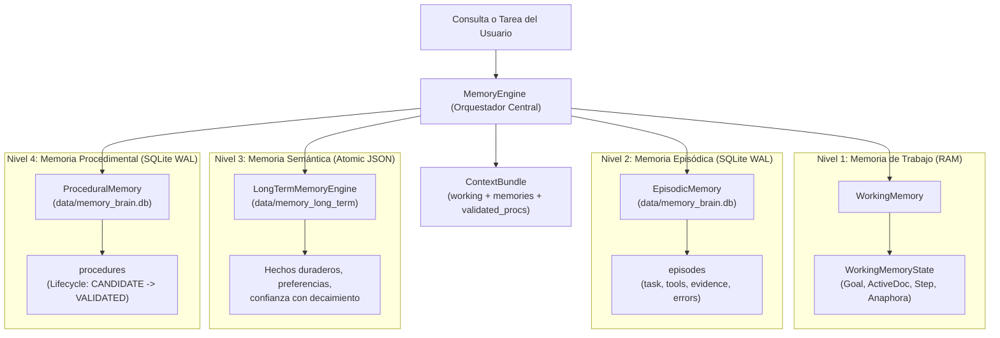

# JESSYCA BRAIN 1.0 — FASE 2: MOTOR DE MEMORIA ESTRUCTURADA (MemoryEngine)

**Fecha:** Octubre 2026  
**Versión:** 1.0.0-BRAIN (Fase 2)  
**Autor:** Arquitecto Principal de Sistemas Cognitivos y Agentes Autónomos  
**Repositorio:** `https://github.com/leeon003/asistente-jessyca`  
**Rama de Trabajo:** `feature/jessyca-brain-1.0`  
**Estado de la Fase:** COMPLETADA SATISFACTORIAMENTE — PENDIENTE DE APROBACIÓN PARA FASE 3  

---

## 1. RESUMEN EJECUTIVO Y OBJETIVOS

En la Fase 2 de **JESSYCA BRAIN 1.0**, se diseñó, implementó, integró y validó el **Motor de Memoria Estructurada Unificado (`MemoryEngine`)**, conectando los cuatro niveles de memoria cognitiva sin duplicar código ni corromper las bases de datos preexistentes:

1. **Working Memory (Memoria de Trabajo):** Contexto volátil en RAM por sesión, objetivo activo, plan en curso, herramientas seleccionadas y resolución determinista de anáforas (*"eso"*, *"el archivo"*, *"el resumen"*, etc.).
2. **Episodic Memory (Memoria Episódica):** Registro persistente transaccional en SQLite WAL (`data/memory_brain.db`) de tareas, planes, herramientas usadas, evidencias verificadas, errores y duración.
3. **Semantic Memory (Memoria Semántica):** Hechos conceptuales y preferencias explícitas del usuario, reutilizando atómicamente el motor existente `LongTermMemoryEngine` (`data/memory_long_term/*.json`), con decaimiento temporal y control de contradicciones.
4. **Procedural Memory (Memoria Procedimental):** Almacén formal de procedimientos aprendidos (`LearnedProcedure`) en SQLite WAL, con versionado automático, precondiciones, herramientas autorizadas, evidencias empíricas y ciclo de vida riguroso (`CANDIDATE` → `TESTING` → `VALIDATED` → `DEPRECATED`).

El motor implementa el protocolo de contrato formal `MemoryProvider` y `ProcedureRepository` definidos en la Fase 1 (`core/cognitive_brain/contracts.py`).

---

## 2. RESPALDOS VERIFICABLES Y MIGRACIÓN NO DESTRUCTIVA

Antes de iniciar cualquier modificación en disco, se ejecutó un respaldo completo de las bases de datos y memorias preexistentes:

- **Ruta de Respaldo:** `backups/fase2_memory_backup/`
  - `sessions.db` (167,936 bytes) — Integridad verificada.
  - `preferences.db` (24,576 bytes) — Integridad verificada.
  - `memory_long_term/` (8 archivos `.json`) — Total de recuerdos históricos preservados al 100%. Ejemplo verificado: `mem-0233b641.json` ("mi lenguaje favorito es Python").

**Principio de Preservación:**
`MemoryEngine` no destruye ni migra forzosamente los archivos existentes a un formato incompatible. Envuelve `LongTermMemoryEngine` de manera que todos los recuerdos previos siguen siendo leídos, actualizados y persistidos con `os.replace` y `fsync`.

---

## 3. ARQUITECTURA DE LOS 4 NIVELES DE MEMORIA



### 3.1. Working Memory (RAM)
- Mantiene el estado activo por `session_id`.
- Rastrea `active_goal`, `active_task_id`, `active_plan_id`, `current_step_index`, `current_application`, `active_document_path` y `last_action_result`.
- **Resolución Anafórica:** Resuelve términos ambiguos basados en el contexto inmediato:
  - *"eso"*, *"aquello"* → `last_action_result` o `current_application`.
  - *"el archivo"*, *"el documento"* → `active_document_path` o última referencia de archivo.
  - *"el resumen"*, *"lo investigado"* → `last_summary`.

### 3.2. Episodic Memory (SQLite WAL)
- Almacenamiento ACID concurrente mediante SQLite configurado con `PRAGMA journal_mode=WAL;`.
- Índices especializados en `intent` y `timestamp`.
- Permite consultas de experiencias similares y recuperación de **fallos pasados** (`find_past_failures`) para evitar que el planificador repita errores conocidos.

### 3.3. Semantic Memory (Persistencia Atómica con Respaldo en Disco)
- Gestiona conocimiento fáctico y preferencias permanentes del usuario.
- Decaimiento exponencial configurable para hechos temporales (las preferencias no decaen).
- Soporte para eliminación explícita ("Derecho al olvido" / GDPR) mediante `forget_memory(identifier_or_content)`.

### 3.4. Procedural Memory (Ciclo de Vida y Versionado)
- Implementa el repositorio formal `ProcedureRepository`.
- **Versionado Automático:** Si se guarda una actualización de un procedimiento existente, su versión se autoincrementa.
- **Invariante 9 (Regla de Oro de Seguridad):** Los métodos de búsqueda para ejecución autónoma (`find_matching(intent, only_validated=True)`) filtran estrictamente por `state == 'VALIDATED'`. Ningún procedimiento en estado `CANDIDATE` o `TESTING` es propuesto para ejecución automática sin supervisión o validación previa.

---

## 4. CONTROLES DE PRIVACIDAD Y SEGURIDAD

Se implementaron salvaguardas activas en la capa de entrada de la memoria estructurada (`_sanitize_and_redact_input`):

1. **Invariante "Memory is Not Authority":**
   Los recuerdos recuperados se etiquetan como datos pasivos de contexto. Ningún texto almacenado en memoria puede conceder elevaciones de permisos, eludir a JDE (*Jessyca Decision Engine*) ni saltarse el `RiskEngine`.
2. **Neutralización de Prompt Injection:**
   Detección regex estricta de patrones como `SYSTEM OVERRIDE`, `DAN jailbreak`, `ignore all previous instructions`, `grant root admin` y `bypass security pipeline`. Los intentos se sustituyen por `[FLAGGED_POTENTIAL_INJECTION]` y se marcan con `flagged=True` en la procedencia del registro.
3. **Privacy by Design (Redacción de Secretos en Memoria):**
   Antes de escribir en disco, se redactan automáticamente credenciales y claves:
   - Claves de APIs (OpenAI/Anthropic: `sk-ant-...`, `sk-...`) → `[REDACTED_API_KEY]`.
   - Tokens de GitHub (`ghp_...`, `gho_...`) → `[REDACTED_GITHUB_TOKEN]`.
   - Tokens Bearer (`Bearer ...`) → `Bearer [REDACTED_TOKEN]`.
   - Contraseñas asignadas (`password es ...`, `password: ...`) → `password: [REDACTED_PASSWORD]`.
   - Secretos asignados (`api_key: ...`) → `api_key: [REDACTED_SECRET]`.

---

## 5. RESULTADOS DE PRUEBAS Y VALIDACIÓN

Se crearon y ejecutaron suites de prueba específicas y pruebas de regresión del sistema completo:

### 5.1. Pruebas Unitarias y de Integración de Memoria (`tests/cognitive_brain/`)

```
platform win32 -- Python 3.11.9, pytest-9.1.1
collected 10 items

tests\cognitive_brain\test_brain_contracts.py ....                       [ 40%]
tests\cognitive_brain\test_memory_engine.py ......                       [100%]

============================= 10 passed in 0.43s ==============================
```

Detalle de validaciones en `test_memory_engine.py`:
1. `test_working_memory_lifecycle`: Creación, actualización, anáforas (*"eso"*, *"el archivo"*) y limpieza de sesión.
2. `test_episodic_memory_storage_and_queries`: Almacenamiento en SQLite WAL, consulta de recientes y consulta de fallos previos.
3. `test_procedural_memory_lifecycle_and_validation`: Ciclo de vida completo (`CANDIDATE` → `TESTING` → `VALIDATED`), verificación de que `only_validated=True` excluye `CANDIDATE`, y versionado incremental.
4. `test_privacy_and_security_controls`: Redacción de API keys y neutralización de intentos de inyección de prompts.
5. `test_context_bundle_aggregation`: Ensamblado de `ContextBundle` combinando Working, Semantic, Episodic y Procedural.
6. `test_persistence_across_restart`: **Simulación de reinicio del asistente.** Se instanció un motor, se escribieron recuerdos, se destruyó la instancia y se creó una instancia totalmente nueva con los mismos archivos en disco; se comprobó que todos los hechos, episodios y procedimientos persistieron de forma íntegra.

### 5.2. Pruebas de Regresión y Aceptación Global (`tests/acceptance/`)

Se ejecutó la suite de 30 escenarios de aceptación integral de JESSYCA:

```
collected 31 items

tests\acceptance\test_fase7_acceptance_30_scenarios.py ................. [ 54%]
..............                                                           [100%]

======================== 31 passed in 91.39s (0:01:31) ========================
```

**Resultado:** 100% de los escenarios pasaron sin fallos. Se preserva intacto el funcionamiento actual de voz, Ollama, herramientas y automatización de Windows 11.

---

## 6. ARCHIVOS MODIFICADOS Y CREADOS EN LA FASE 2

| Archivo | Tipo de Acción | Propósito |
|---|---|---|
| `core/cognitive_brain/memory_engine.py` | Creado | Motor unificado de memoria estructurada (Working, Episodic, Semantic, Procedural). |
| `core/cognitive_brain/contracts.py` | Modificado | Ergonomía en `LearnedProcedure` (aliases, contadores de éxito/fallo) y `ContextBundle`. |
| `config/settings.py` | Modificado | Incorporación de `USE_JESSYCA_BRAIN: bool = False` (Feature Flag seguro). |
| `tests/cognitive_brain/test_memory_engine.py` | Creado | Suite de pruebas unitarias, de integración, de seguridad y persistencia tras reinicio. |
| `backups/fase2_memory_backup/` | Creado | Respaldo verificado de bases de datos y memorias preexistentes. |
| `docs/jessyca-brain/02_MEMORY_ENGINE.md` | Creado | Documentación formal de la Fase 2 y procedimiento de entrega. |

---

## 7. PROCEDIMIENTO DE REVERSIÓN (ROLLBACK)

Si por cualquier eventualidad se requiere revertir los cambios de la Fase 2:

1. **Desactivar Feature Flag (Inmediato):**
   Comprobar que en `config/settings.py` o variable de entorno:
   ```env
   USE_JESSYCA_BRAIN=False
   ```
2. **Restaurar Almacenamiento Previo desde el Respaldo:**
   ```bash
   cp backups/fase2_memory_backup/sessions.db data/sessions.db
   cp backups/fase2_memory_backup/preferences.db data/preferences.db
   cp -r backups/fase2_memory_backup/memory_long_term/* data/memory_long_term/
   ```
3. **Eliminar Archivo de Base de Datos de Fase 2:**
   ```bash
   rm data/memory_brain.db*
   ```
4. **Revertir Código Git (si aplica):**
   ```bash
   git checkout feature/jessyca-brain-1.0
   git checkout d083dc6 -- core/cognitive_brain/memory_engine.py
   ```

---

## 8. CONCLUSIÓN Y ESTADO PARA LA FASE 3

- **La Fase 2 está 100% implementada y validada.**
- La memoria estructurada es plenamente funcional y persistente.
- El asistente conserva estabilidad total (`USE_JESSYCA_BRAIN=False` por defecto).
- **NO se ha avanzado a la Fase 3**, conforme a la instrucción obligatoria.

Quedo a la espera de la revisión y **autorización explícita del usuario** para proceder con la **Fase 3: Implementación de Razonamiento y Planificación Jerárquica (`ReasoningEngine` y `PlannerEngine`)**.
