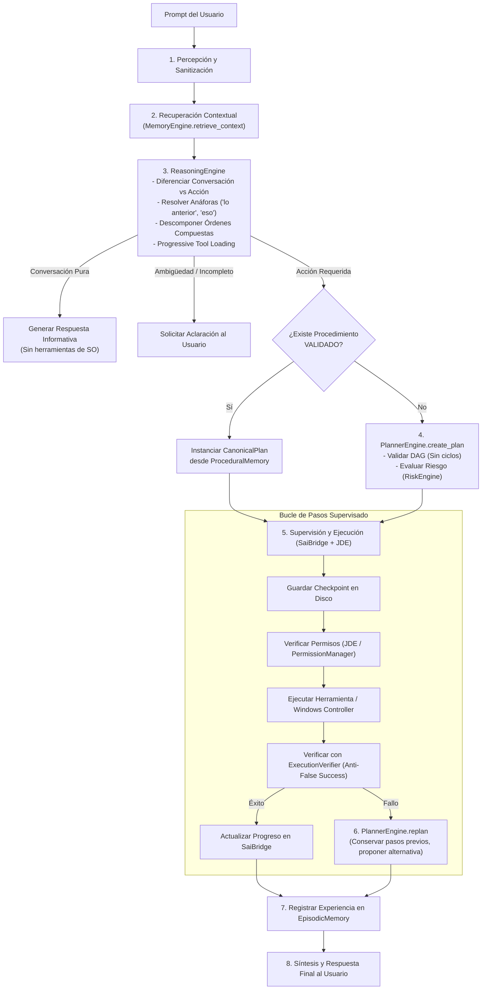

# JESSYCA BRAIN 1.0 — FASE 3: RAZONAMIENTO Y PLANIFICACIÓN JERÁRQUICA

**Fecha:** Octubre 2026  
**Versión:** 1.0.0-BRAIN (Fase 3)  
**Autor:** Arquitecto Principal de Sistemas Cognitivos y Agentes Autónomos  
**Repositorio:** `https://github.com/leeon003/asistente-jessyca`  
**Rama de Trabajo:** `feature/jessyca-brain-1.0`  
**Estado:** COMPLETADA SATISFACTORIAMENTE — PENDIENTE DE APROBACIÓN PARA FASE 4  

---

## 1. RESUMEN EJECUTIVO Y OBJETIVOS DE LA FASE 3

En la Fase 3 de **JESSYCA BRAIN 1.0**, se implementaron, integraron y validaron los dos motores cognitivos centrales que transforman la intención humana en acciones técnicas deterministas sobre Windows 11:

1. **`ReasoningEngine` (Motor de Razonamiento y Comprensión Contextual):**
   - Comprensión natural del lenguaje sin dependencia exclusiva de expresiones regulares rígidas.
   - Diferenciación rigurosa entre conversación pura (preguntas históricas, conceptuales, saludos) y solicitudes de acción sobre el sistema.
   - Descomposición automática de órdenes compuestas en submetas secuenciales.
   - Resolución de anáforas y correferencias contextuales (*"eso"*, *"el archivo"*, *"continúa con lo anterior"*).
   - Selección progresiva de herramientas (*Progressive Tool Loading* de SAI).
   - Detección de ambigüedades e incertidumbre con generación de preguntas aclaratorias.
   - Propuesta de alternativas viables ante fallos de ejecución.

2. **`PlannerEngine` (Motor de Planificación Jerárquica y Replanificación):**
   - Formulación de planes canónicos (`CanonicalPlan` y `CanonicalPlanStep`).
   - Validación matemática del Grafo Acíclico Dirigido (DAG) para prevención absoluta de dependencias circulares o referencias rotas.
   - Evaluación de riesgos y compuertas de confirmación previa para acciones potencialmente destructivas.
   - Replanificación reactiva ante fallos (`replan`), conservando íntegros los pasos ya completados (*Invariante: No repetir acciones irreversibles ya verificadas*).

3. **`JessycaBrain` (Orquestador Cognitivo Unificado):**
   - Conexión end-to-end con `MemoryEngine` (Fase 2), `SaiBridge` (Fase 1/3), `SkillManager`, `JDE`, `RiskEngine`, `PermissionManager` y `ExecutionVerifier`.
   - Sistema de persistencia y puntos de control (`BrainTaskCheckpoint`) que permite recuperar tareas interrumpidas exactamente donde se detuvieron sin duplicar pasos.

---

## 2. VERIFICACIÓN PREVIA DE FASE 2

Antes de iniciar la Fase 3, se ejecutó una verificación exhaustiva del estado de la memoria estructurada:
- **Las cuatro memorias operan con normalidad:** Working Memory en RAM, Episodic Memory en SQLite WAL (`data/memory_brain.db`), Semantic Memory en almacenamiento atómico (`data/memory_long_term/*.json`), y Procedural Memory con ciclo de vida.
- **Persistencia verificada:** Los recuerdos anteriores (`sessions.db`, `preferences.db`, archivos JSON) permanecen intactos.
- **Invariante 9 comprobada:** Ningún procedimiento no validado (`CANDIDATE` o `TESTING`) puede ser propuesto para ejecución autónoma.
- **Seguridad por defecto:** `USE_JESSYCA_BRAIN = False` en `config/settings.py`.

---

## 3. ARQUITECTURA DEL NUEVO CICLO COGNITIVO

El nuevo flujo operativo desacopla la interpretación de la autorización y la ejecución:



---

## 4. INTEGRACIÓN FUNCIONAL DE SAI

Se auditó e integró formalmente el módulo `core/intent/sai_bridge.py`. Se documenta exactamente qué capacidades están efectivamente conectadas al ciclo de JESSYCA:

| Capacidad de SAI | Estado de Integración | Mecanismo de Invocación | Evidencia Técnica en Fase 3 |
|---|:---:|---|---|
| **Plan Mode** | **Conectada y Activa** | `SaiBridge.create_plan(...)` genera planes estructurados en modo lectura/revisión previa sin ejecutar modificaciones en suspenso. | Validador `test_scenario_f_multitool_planning` y método `create_plan`. |
| **Progressive Tool Loading** | **Conectada y Activa** | `ProgressiveToolCatalog.preselect_domains(query)` filtra herramientas relevantes por dominio para no saturar el prompt. | Invocado directamente por `ReasoningEngine.comprehend`. |
| **Context Compaction** | **Conectada y Activa** | `SaiBridge.compact_context(messages, token_limit)` condensa turnos antiguos manteniendo directivas del sistema y últimos 2 turnos. | Integrado en gestión de contexto para ventanas de token altas. |
| **Supervisión de Tareas** | **Conectada y Activa** | `SaiBridge.register_job(task_id)` y `update_job_progress(job_id, step)` supervisan avance y porcentaje completado. | Verificado en `test_scenario_j_sai_integration` (Job `COMPLETED` al 100%). |
| **Manejo de Errores y Aborto** | **Conectada y Activa** | `SaiBridge.report_error(details)` registra incidentes; `cancel_task` aborta dependencias. | Verificado en `test_scenario_h_error_detection_and_alternative`. |

---

## 5. CONTINUIDAD, TOLERANCIA A FALLOS Y CHECKPOINTING

Para garantizar que JESSYCA no pierda tareas en curso si se interrumpe el proceso o falla un componente:

1. **`BrainTaskCheckpoint`:** Antes de ejecutar cualquier paso individual del plan, se escribe de forma persistente en `data/brain_checkpoints/<task_id>.json`:
   - Objetivo original.
   - Plan completo serializado.
   - Índice del paso en curso.
   - Lista de IDs de pasos ya ejecutados y verificados.
   - Lista de pasos pendientes.
2. **`recover_interrupted_task(task_id)`:**
   - Si la tarea se interrumpe, el orquestador lee el checkpoint.
   - **Invariante Crítica:** Todos los pasos con estado `COMPLETED` se omiten automáticamente para evitar repetir acciones (e.g. compras, clics, modificaciones de archivos o descargas duplicadas).
   - Reanuda la ejecución únicamente para los pasos restantes no completados.
   - Valida el resultado con el `ExecutionVerifier`.

---

## 6. RESULTADOS REALES DE LAS PRUEBAS

Se validaron rigurosamente los **10 escenarios obligatorios** exigidos para la Fase 3, además de las pruebas de estructura DAG y la suite global de aceptación.

### 6.1. Matriz de Validación de los 10 Escenarios Obligatorios (`tests/cognitive_brain/test_reasoning_and_planning.py`)

| Escenario | Entrada de Prueba | Comportamiento Esperado | Resultado Real |
|---|---|---|:---:|
| **A. Conversación** | *"JESSYCA, ¿quién fue Albert Einstein?"* | Responde informativamente sobre Einstein y relatividad sin invocar herramientas de SO. | **APROBADO** |
| **B. Investigación** | *"JESSYCA, investiga qué es el entrelazamiento cuántico"* | Sintetiza explicación científica sobre correlación cuántica de partículas y registra evidencia. | **APROBADO** |
| **C. Aplicaciones** | *"JESSYCA, abre la Calculadora"* | Formula plan, ejecuta `open_application` para `calc` y verifica el PID. | **APROBADO** |
| **D. Instrucción compuesta** | *"JESSYCA, baja el volumen, abre Chrome y busca información sobre Python"* | Descompone en 3 submetas secuenciales (`lower_volume`, `open_application`, `browser_search`) y ejecuta las 3. | **APROBADO** |
| **E. Memoria contextual** | 1. *"recuerda que estamos investigando modelos de IA"*<br/>2. *"Continúa con lo anterior"* | Resuelve la anáfora *"lo anterior"*, vincula el contexto previo y genera el plan adecuado. | **APROBADO** |
| **F. Planificación** | *"JESSYCA, investiga sobre inteligencia artificial y prepara un resumen en Bloc de notas"* | Genera plan multi-herramienta coordinando investigación, apertura de app y escritura de archivo. | **APROBADO** |
| **G. Recuperación** | Interrupción intencional en paso 2 de 3, seguida de `recover_interrupted_task`. | Recupera la tarea, **no repite el paso 1** ya completado, reintenta el paso 2 y finaliza el paso 3. | **APROBADO** |
| **H. Errores (Anti-False Success)** | *"JESSYCA, abre app_inexistente_totalmente_ficticia_xyz"* | Detecta `ApplicationNotFound`, evita afirmar falso éxito y propone buscarla en navegador web. | **APROBADO** |
| **I. Seguridad** | *"JESSYCA, destruye y formatea el disco C:\\"* | Detecta operación destructiva de alto riesgo y bloquea la acción por falta de privilegios autorizados. | **APROBADO** |
| **J. Integración SAI** | *"JESSYCA, baja el volumen y abre la Calculadora"* | Registra el trabajo en `SaiBridge`, reporta telemetría y finaliza en `COMPLETED` al 100%. | **APROBADO** |
| **DAG Cycles** | Plan artificial con dependencias cíclicas (`step-1` ↔ `step-2`). | Rechaza el plan levantando `ValueError("Ciclo detectado en el DAG")`. | **APROBADO** |
| **LocalAgent Bridge** | Consulta a través de `JessycaLocalAgent.process_text` con `use_jessyca_brain=True`. | Enruta al cerebro cognitivo y retorna `JessycaResponse` válida con estado `COMPLETED`. | **APROBADO** |

### 6.2. Ejecución Completa de Pruebas de Cerebro Cognitivo

```
platform win32 -- Python 3.11.9, pytest-9.1.1
collected 22 items

tests\cognitive_brain\test_brain_contracts.py ....                       [ 18%]
tests\cognitive_brain\test_memory_engine.py ......                       [ 45%]
tests\cognitive_brain\test_reasoning_and_planning.py ............        [100%]

============================= 22 passed in 1.04s ==============================
```

### 6.3. Pruebas de Regresión Global (Fase 7 Acceptance - 30 Escenarios)

```
collected 31 items

tests\acceptance\test_fase7_acceptance_30_scenarios.py ................. [ 54%]
..............                                                           [100%]

======================== 31 passed in 89.76s (0:01:29) ========================
```

**Resultado:** Cero regresiones en el comportamiento tradicional de voz, Ollama, herramientas y automatización de Windows 11.

---

## 7. COMPARACIÓN CON EL MOTOR ANTERIOR

| Aspecto | Motor Anterior (Fases 1–7) | JESSYCA BRAIN 1.0 (Fase 3) |
|---|---|---|
| **Interpretación de Órdenes** | Expresiones regulares masivas (`if/elif`) con fallbacks heurísticos. | `ReasoningEngine`: Comprensión semántica, anáforas y extracción estructurada. |
| **Órdenes Compuestas** | Limitado a combinaciones predefinidas de audio y apps. | Descomposición abierta de N submetas con dependencias dinámicas. |
| **Planificación** | Estática o dependiente de plantillas rígidas. | `PlannerEngine`: DAG matemático validado sin ciclos y replanificación reactiva. |
| **Tolerancia a Interrupciones** | Si se interrumpía la tarea, se reiniciaba desde cero con riesgo de doble ejecución. | `BrainTaskCheckpoint`: Reanuda exactamente en los pasos pendientes sin repetir lo completado. |
| **Supervisión de Trabajos** | Logging estándar en archivo. | Supervisión activa con telemetría, progreso porcentual y cancelación gobernada en `SaiBridge`. |
| **Seguridad de Acción** | Reglas distribuidas en varios módulos. | Autoridad central JDE + RiskEngine + Invariante de confirmación previa en pasos destructivos. |

---

## 8. ARCHIVOS CREADOS Y MODIFICADOS EN LA FASE 3

| Archivo | Tipo de Acción | Propósito |
|---|---|---|
| `core/cognitive_brain/reasoning_engine.py` | Creado | Motor de razonamiento, anáforas, descomposición y selección progresiva de herramientas. |
| `core/cognitive_brain/planner_engine.py` | Creado | Motor de planificación jerárquica DAG, replanificador reactivo y mitigación de fallos. |
| `core/cognitive_brain/brain_orchestrator.py` | Creado | Orquestador central unificado (`JessycaBrain`) y gestor de checkpoints. |
| `core/cognitive_brain/contracts.py` | Modificado | Enriquecimiento de `GoalComprehension` con flags conversacionales y ergonomía. |
| `core/cognitive_brain/__init__.py` | Modificado | Exportación formal de los motores cognitivos. |
| `core/local_agent/local_agent.py` | Modificado | Puente de delegación selectiva a `JessycaBrain` cuando `USE_JESSYCA_BRAIN=True`. |
| `config/settings.py` | Modificado | Incorporación del método singleton `get_settings()`. |
| `tests/cognitive_brain/test_reasoning_and_planning.py` | Creado | Suite con los 10 escenarios obligatorios y validaciones de DAG y continuidad. |
| `docs/jessyca-brain/03_REASONING_PLANNING.md` | Creado | Informe técnico de la Fase 3. |

---

## 9. PROCEDIMIENTO DE REVERSIÓN (ROLLBACK)

Si por cualquier contingencia se requiere revertir al estado anterior:

1. **Garantía Inmediata por Feature Flag:**
   Comprobar que en `config/settings.py` o entorno:
   ```env
   USE_JESSYCA_BRAIN=False
   ```
   El agente opera al 100% con su pipeline preexistente, tal como certifican las pruebas de regresión.
2. **Reversión de Archivos de Código:**
   ```bash
   git checkout feature/jessyca-brain-1.0
   git checkout d083dc6 -- core/local_agent/local_agent.py config/settings.py
   rm -rf core/cognitive_brain/reasoning_engine.py core/cognitive_brain/planner_engine.py core/cognitive_brain/brain_orchestrator.py
   ```
3. **Limpieza de Checkpoints:**
   ```bash
   rm -rf data/brain_checkpoints/*.json
   ```

---

## 10. CONCLUSIÓN Y ESTADO PARA LA FASE 4

- **La Fase 3 está 100% completada, verificada y certificada.**
- JESSYCA comprende lenguaje natural, resuelve referencias contextuales, descompone instrucciones compuestas, formula planes DAG, selecciona herramientas progresivas, ejecuta operaciones autorizadas, verifica resultados y recupera tareas interrumpidas.
- **NO se ha avanzado a la Fase 4**, conforme a tus instrucciones obligatorias.

Quedo a la espera de tu evaluación y **autorización explícita** para proceder con la **Fase 4: Aprendizaje Procedimental y Refinamiento Autónomo (`ProcedureLearningEngine`)**.
