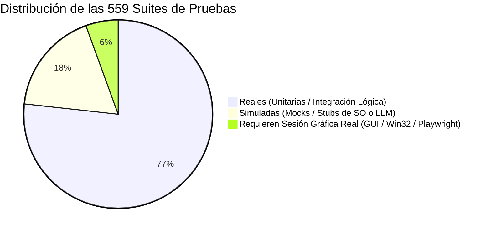

# JESSYCA 4.0 — FASE 0: INVENTARIO DE ARQUITECTURA Y SUBSISTEMAS

**Fecha de Generación:** 16 de Octubre de 2026  
**Rama:** `feature/jessyca-4-agent`  
**Propósito:** Mapeo exhaustivo de archivos, módulos, puntos de entrada y categorías de pruebas del asistente personal JESSYCA.

---

## 1. Mapeo de Puntos de Entrada y Módulos Críticos

### 1.1 Punto de Inicio del Agente (Agent Core)
* **Punto de Entrada CLI / Demo:** [`main.py`](file:///d:/JESSYCA%203.0/asistente-jessyca/main.py)
* **Núcleo Unificado del Agente Local:** [`core/local_agent/local_agent.py`](file:///d:/JESSYCA%203.0/asistente-jessyca/core/local_agent/local_agent.py)
  * Clase principal: `JessycaLocalAgent` (Patrón Singleton con `get_instance()`).
  * Métodos de entrada: `interact()` (procesamiento síncrono gobernado) e `interact_stream()` (emisión en streaming respetando Anti-False Success).
* **Configuración Central:** [`config/settings.py`](file:///d:/JESSYCA%203.0/asistente-jessyca/config/settings.py) y [`config/manager.py`](file:///d:/JESSYCA%203.0/asistente-jessyca/config/manager.py)

### 1.2 Subsistema de Voz (Audio, STT, TTS, VAD, Wake Word)
* **Interfaz de Voz Local:** [`core/local_agent/voice_interface.py`](file:///d:/JESSYCA%203.0/asistente-jessyca/core/local_agent/voice_interface.py)
* **Normalizador Fonético y STT:** [`core/local_agent/stt_normalizer.py`](file:///d:/JESSYCA%203.0/asistente-jessyca/core/local_agent/stt_normalizer.py)
* **Detección de Voz Activa (VAD):** Silero VAD vía `SILERO_VAD_MODEL_PATH`
* **Transcriptor de Voz (STT):** Faster Whisper con soporte CUDA y fallback automático a CPU.
* **Activación por Voz (Wake Word):** openWakeWord ("Hey Jessyca") integrado con control de parada de emergencia.

### 1.3 Subsistema de Herramientas y Habilidades (Skills Framework)
* **Gestor Central de Habilidades:** [`skills/skill_manager.py`](file:///d:/JESSYCA%203.0/asistente-jessyca/skills/skill_manager.py) y [`skills/registry.py`](file:///d:/JESSYCA%203.0/asistente-jessyca/skills/registry.py)
* **Aplicaciones de Windows:** [`skills/apps_skill.py`](file:///d:/JESSYCA%203.0/asistente-jessyca/skills/apps_skill.py) (`windows.apps`)
* **Sistema de Archivos Sandbox:** [`skills/files_skills.py`](file:///d:/JESSYCA%203.0/asistente-jessyca/skills/files_skills.py) (`files.read`, `files.create`, `files.copy`, `files.move`, `files.rename`, `files.list`, `files.metadata`, `files.organize`)
* **Navegación e Investigación Web:**
  * [`skills/browser_search_skill.py`](file:///d:/JESSYCA%203.0/asistente-jessyca/skills/browser_search_skill.py) (`browser.search`)
  * [`skills/browser_skills.py`](file:///d:/JESSYCA%203.0/asistente-jessyca/skills/browser_skills.py) (`browser.open`, `browser.navigate`, `browser.read`, `browser.download`)
  * [`skills/browser_youtube_skill.py`](file:///d:/JESSYCA%203.0/asistente-jessyca/skills/browser_youtube_skill.py) (`browser.youtube`)
* **Uso de Computadora e Interacción GUI (Computer Use):**
  * [`skills/computer_use_skill.py`](file:///d:/JESSYCA%203.0/asistente-jessyca/skills/computer_use_skill.py)
  * [`core/integration/adapters/computer_use_adapter.py`](file:///d:/JESSYCA%203.0/asistente-jessyca/core/integration/adapters/computer_use_adapter.py)
  * [`core/desktop/driver_protocol.py`](file:///d:/JESSYCA%203.0/asistente-jessyca/core/desktop/driver_protocol.py) (Abstracción de driver desacoplada)
* **Operaciones Documentales:** [`skills/documents_skills.py`](file:///d:/JESSYCA%203.0/asistente-jessyca/skills/documents_skills.py) (`documents.read`, `documents.create`, `documents.summarize`, `documents.convert`)

### 1.4 Subsistema de Memoria y Contexto
* **Contexto a Corto Plazo (Conversación Activa):** [`core/local_agent/conversation_context.py`](file:///d:/JESSYCA%203.0/asistente-jessyca/core/local_agent/conversation_context.py)
  * Control de turnos, desambiguación anafórica ("ábrelo", "eso") y estado de diálogo multi-turno.
* **Memoria a Largo Plazo Persistente:** [`core/memory/long_term_memory.py`](file:///d:/JESSYCA%203.0/asistente-jessyca/core/memory/long_term_memory.py)
  * Almacenamiento tipado (`SEMANTIC_MEMORY`, `USER_PREFERENCES`, `EPISODIC_EXPERIENCE`).
  * Motor híbrido SQLite + vectores de embedding local.

### 1.5 Subsistema de Planificación y Razonamiento
* **Motor Agéntico SAI (JESSYCA 4.0):** [`core/intent/sai_intent_engine.py`](file:///d:/JESSYCA%203.0/asistente-jessyca/core/intent/sai_intent_engine.py)
  * Catálogo progresivo bajo demanda: [`core/intent/progressive_catalog.py`](file:///d:/JESSYCA%203.0/asistente-jessyca/core/intent/progressive_catalog.py)
  * Descomposición de planes multi-paso en [`core/local_agent/local_agent.py#L2186`](file:///d:/JESSYCA%203.0/asistente-jessyca/core/local_agent/local_agent.py#L2186) (`multistep_compound`).
* **Autonomous Reasoning Engine (ARE):** [`core/are/runtime.py`](file:///d:/JESSYCA%203.0/asistente-jessyca/core/are/runtime.py) (Modos `DISABLED`, `SHADOW`, `CONTROLLED`, `ACTIVE`).
* **Coordinador del Sistema:** [`core/system/system_coordinator.py`](file:///d:/JESSYCA%203.0/asistente-jessyca/core/system/system_coordinator.py) (`SystemCoordinator4`).

### 1.6 Subsistema de Verificación y Gobernanza de Seguridad
* **Verificador Canónico de Efectos Reales:** [`core/execution/execution_verifier.py`](file:///d:/JESSYCA%203.0/asistente-jessyca/core/execution/execution_verifier.py)
  * Evita el *False Success* comprobando que los procesos, ventanas, archivos o URLs realmente existan y respondan.
* **Protección de Idempotencia y Prevención de Duplicados:** [`core/execution/idempotency_guard.py`](file:///d:/JESSYCA%203.0/asistente-jessyca/core/execution/idempotency_guard.py)
* **Jessyca Decision Engine (JDE Runtime Binding):** [`core/jde/runtime_binding.py`](file:///d:/JESSYCA%203.0/asistente-jessyca/core/jde/runtime_binding.py)
* **Motor de Riesgos y Evaluación de Seguridad:** [`core/risk_engine.py`](file:///d:/JESSYCA%203.0/asistente-jessyca/core/risk_engine.py)
* **Gestor de Permisos y Políticas:** [`core/permission_manager.py`](file:///d:/JESSYCA%203.0/asistente-jessyca/core/permission_manager.py)
* **Parada de Emergencia Inmutable (Kill-Switch):** [`core/emergency_stop.py`](file:///d:/JESSYCA%203.0/asistente-jessyca/core/emergency_stop.py)

---

## 2. Clasificación Exhaustiva de la Suite de Pruebas

El repositorio contiene **559 archivos de pruebas** distribuidos según el tipo de ejecución:

### 2.1 Pruebas Reales (429 suites)
* **Características:** No dependen de que haya un monitor encendido, ni de PyAutoGUI, ni de servidores externos. Ejecutan lógica pura de validación determinista.
* **Ejemplos destacados:**
  * `tests/intent/test_sai_intent_benchmark.py`: Pruebas de descomposición de intenciones y análisis de prompts reales.
  * `tests/jde/test_shadow_integration.py`: Validación de la observación pasiva de JDE sin efectos secundarios.
  * `tests/execution/test_execution_verification.py`: Verificación de algoritmos de detección de ventanas y contratos.
  * `tests/memory/`: Validaciones de persistencia SQLite y rotación de contexto.
  * `tests/security/`: Pruebas de contención de sandbox, bloqueo de rutas críticas de Windows y rechazo de extensiones ejecutables.

### 2.2 Pruebas Simuladas / Con Mocks (99 suites)
* **Características:** Emplean `unittest.mock`, `MagicMock` o `monkeypatch` para desacoplar llamadas a hardware físico (micrófono, altavoces), servicios LLM (Ollama no disponible en CI) o sockets de red.
* **Ejemplos destacados:**
  * `tests/intent/test_sai_intent_integration.py`: Simula el retorno de las skills para certificar que el orquestador encadena planes multi-paso sin alterar el sistema operativo.
  * `tests/router/test_shadow_mode.py`: Simula la latencia de inferencia y las respuestas de modelos sin consumir recursos de GPU.
  * `tests/interfaces/webui_bridge/`: Simula peticiones HTTP a OpenWebUI.

### 2.3 Pruebas que Requieren Sesión Gráfica Real (31 suites)
* **Características:** Interactúan directamente con el subsistema gráfico de Windows (Win32 GDI, `ImageGrab.grab()`, captura de pantalla, PyAutoGUI o navegador Playwright visible). En entornos headless de Linux o runners sin pantalla física, estas pruebas deben contar con mocks o fallbacks (como `NativeWindowsDriver`).
* **Ejemplos destacados:**
  * `tests/skills/test_real_file_and_app_capabilities.py`: Abre y manipula aplicaciones reales en pantalla.
  * `tests/notepad_semantic_execution.py`: Escribe texto real en el Bloc de notas mediante simulación de pulsaciones.
  * `tests/skills/test_browser_youtube_skill.py`: Lanza un navegador real y navega a YouTube.
  * `tests/eval/eval_cua_skill.py`: Evaluación cuantitativa de agentes de pantalla.
