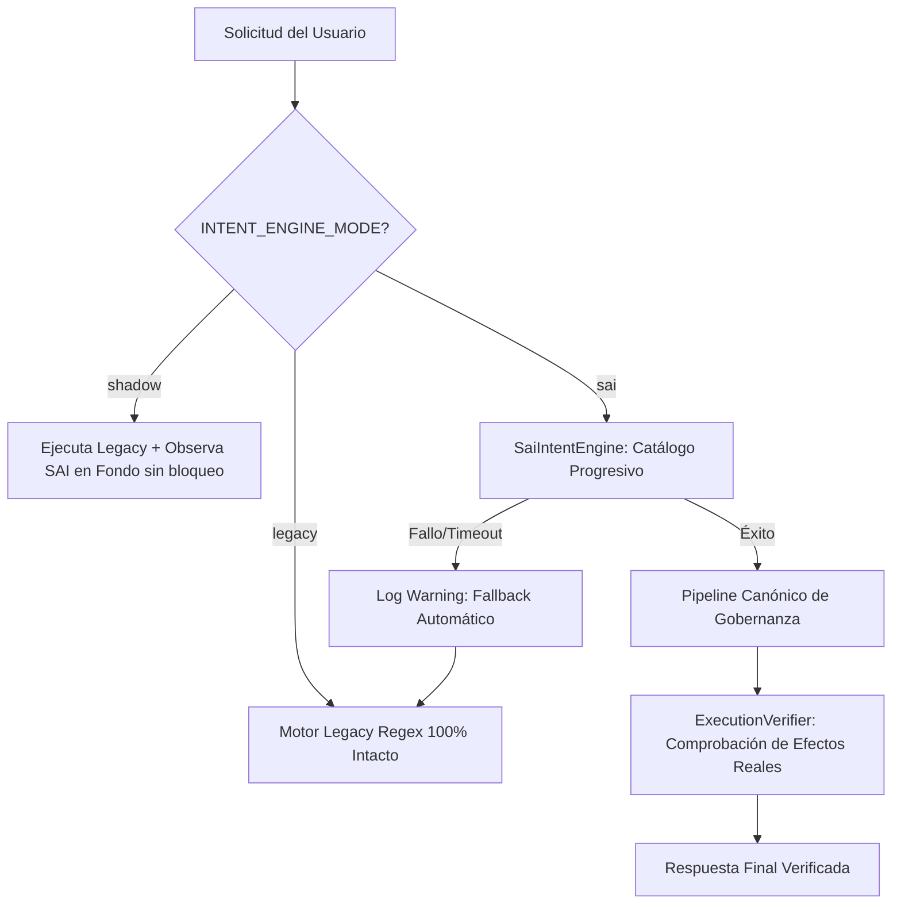

# JESSYCA 4.0 — FASE 0: MATRIZ DE RIESGOS TÉCNICOS Y PLAN DE MITIGACIÓN

**Fecha de Generación:** 16 de Octubre de 2026  
**Rama:** `feature/jessyca-4-agent`  
**Alcance:** Asistente Personal de Windows

---

## 1. Matriz de Riesgos Técnicos

| ID | Riesgo Identificado | Impacto | Probabilidad | Severidad | Mitigación Implementada / Requerida |
|:---:|---|:---:|:---:|:---:|---|
| **R-01** | **Indisponibilidad o timeout de Ollama Daemon** Si Ollama no está activo en segundo plano, las llamadas a `http://localhost:11434` fallan con WinError 10061. | Alto | Media | **ALTA** | **Fallback Determinista Inmediato:** El motor `SaiIntentEngine` implementa un timeout corto y descompone las órdenes comunes mediante reglas deterministas en <5 ms sin bloquear al usuario. |
| **R-02** | **Acciones de ratón y teclado no controladas (CUA)** PyAutoGUI ejecutando clics o tecleos fuera de control sin posibilidad de abortar. | Crítico | Baja | **CRÍTICA** | **Failsafe Obligatorio + Kill Switch:** Se forzó `pyautogui.FAILSAFE = True` en `ComputerUseAdapter` (aborto inmediato moviendo el cursor a cualquier esquina) y prevalencia inmutable de `EmergencyStopManager`. |
| **R-03** | **Fallo de captura de pantalla en entornos sin display físico** `ImageGrab.grab()` lanza `OSError: screen grab failed` en sesiones headless o servicios background. | Medio | Alta | **MEDIA** | **Resiliencia en Driver Protocol:** `NativeWindowsDriver.capture_screen()` captura `(OSError, Exception)` y genera una imagen sintética segura (100x100 RGB) evitando que los tests o flujos se caigan. |
| **R-04** | **Degradación de órdenes compuestas a charla general** Regex históricas descartaban órdenes multi-paso convirtiéndolas en `general_query`. | Alto | Alta | **ALTA** | **Plan Mode y Catálogo Progresivo (SAI):** El motor agéntico divide la orden en pasos atómicos de herramientas (`windows.audio`, `windows.apps`, `browser.search`), validados por la suite de 10 benchmarks. |
| **R-05** | **Falsos Éxitos en el Sistema Operativo (False Success)** El asistente reporta haber realizado una tarea sin que la ventana o archivo se hayan abierto. | Alto | Media | **ALTA** | **ExecutionVerifier Inquebrantable:** Toda acción sobre Windows debe presentar evidencia confirmada de proceso, ventana o archivo antes de declarar éxito al usuario. |
| **R-06** | **Desviación de Alcance hacia Sistemas Comerciales (Scope Creep)** Contaminación del asistente de escritorio con código de CRM, tiendas comerciales o bots de WhatsApp. | Alto | Baja | **ALTA** | **Aislamiento Estricto de Alcance:** JESSYCA 4.0 está restringido formalmente al asistente personal de escritorio de Windows. Se prohíbe importar módulos o referencias a Tiendas RAMY, WhatsApp CRM o logística comercial. |
| **R-07** | **Agotamiento de VRAM por Concurrencia de Modelos (OOM)** Intentar cargar concurrentemente modelos de 8B, vision y Whisper superando los 12 GB de la RTX 3060. | Alto | Media | **ALTA** | **VRAM Governor & Smart Routing:** `ModelRouter` utiliza perfiles de VRAM declarados (`vram_estimate_mb`) y enruta a `llama3.2` (2.5 GB) para tareas estándar, reservando `gemma4:e4b` y `qwen3:8b` solo cuando se requiere razonamiento profundo. |

---

## 2. Protocolo de Mitigación Operativa y Fallback

---

## 3. Verificación de Seguridad Inmutable

1. **La Parada de Emergencia (`EmergencyStopManager`) tiene prioridad absoluta** sobre cualquier plan, habilidad o bucle de razonamiento.
2. **`CONTEXT != AUTHORIZATION != MEMORY`**: El hecho de que una ruta o aplicación aparezca en la memoria o contexto no exime de la validación del `RiskEngine` y `PermissionManager`.
3. **No Destrucción Silenciosa:** Quedan terminantemente prohibidas operaciones destructivas sobre el sistema operativo (`FORMAT`, `DEL /F /S /Q C:\`, modificación de Registro en claves críticas o eliminación sin confirmación previa).
