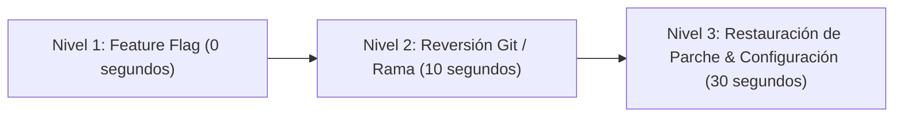

# JESSYCA 4.0 — FASE 0: PROCEDIMIENTO DE ROLLBACK DETERMINISTA

**Fecha de Generación:** 16 de Octubre de 2026  
**Rama:** `feature/jessyca-4-agent`  
**Propósito:** Garantizar que cualquier cambio posterior pueda ser revertido de inmediato a un estado 100% reproducible y verificado sin pérdida de información personal ni de trabajo previo.

---

## 1. Niveles de Rollback Disponibles

El sistema cuenta con tres niveles graduales de reversión, desde el más rápido (sin reiniciar el sistema) hasta la restauración atómica completa a nivel de código y dependencias.



---

## 2. Nivel 1: Conmutación en Tiempo de Ejecución (Zero Downtime)

Si se detecta cualquier anomalía con el nuevo motor agéntico SAI o con la descomposición de intenciones, **no es necesario reiniciar el código ni compilar**:

### Método A: Variable de Entorno
Establecer en la sesión o en el archivo `.env`:
```bash
INTENT_ENGINE_MODE=legacy
```
* **Efecto:** El agente conmuta inmediatamente al motor clásico de expresiones regulares. Todo el código nuevo de SAI queda en reposo sin ser invocado.

### Método B: Vía Configuración Programática
```python
from config import get_settings
# La configuración por defecto es 'legacy'
assert get_settings().INTENT_ENGINE_MODE == "legacy"
```

---

## 3. Nivel 2: Reversión de Rama de Desarrollo

La totalidad de los desarrollos de JESSYCA 4.0 se encuentran contenidos en la rama aislada `feature/jessyca-4-agent`.

Para volver a la rama de evaluación previa (`eval/gui-agents`):
```bash
# 1. Verificar estado limpio
git status

# 2. Conmutar a la rama anterior
git checkout eval/gui-agents
```
Para volver a la rama principal estable (`main`):
```bash
git checkout main
```

---

## 4. Nivel 3: Restauración Atómica desde Parche de Respaldo

En el directorio `backups/` se ha preservado el estado exacto del working tree antes de iniciar la modernización:

* **Parche de cambios locales previos:** [`backups/baseline_working_tree.patch`](file:///d:/JESSYCA%203.0/asistente-jessyca/backups/baseline_working_tree.patch)
* **Lista de archivos untracked:** [`backups/baseline_status.txt`](file:///d:/JESSYCA%203.0/asistente-jessyca/backups/baseline_status.txt)
* **Configuración sanitizada:** [`backups/effective_config_sanitized.json`](file:///d:/JESSYCA%203.0/asistente-jessyca/backups/effective_config_sanitized.json)
* **Congelamiento de dependencias de Python:** [`docs/jessyca4/requirements_freeze_baseline.txt`](file:///d:/JESSYCA%203.0/asistente-jessyca/docs/jessyca4/requirements_freeze_baseline.txt)

### Procedimiento de Aplicación del Parche de Respaldo:
```bash
# 1. Descartar cambios no deseados en la rama
git checkout -- .

# 2. Aplicar el parche de respaldo del baseline
git apply backups/baseline_working_tree.patch

# 3. Validar estado restaurado
git status
```

---

## 5. Procedimiento de Verificación Post-Rollback

Tras aplicar cualquier nivel de reversión, ejecutar el script de verificación segura para certificar que el sistema opera al 100%:

```bash
pytest tests/intent/test_sai_intent_benchmark.py tests/router/test_shadow_mode.py tests/execution/test_execution_verification.py -v
```

**Criterio de Aceptación:**
* Todas las pruebas seleccionadas finalizan con código de salida `0` (verde).
* No existen excepciones no capturadas ni corrupción en `data/sessions.db`.
* La parada de emergencia (`EmergencyStopManager`) responde de inmediato ante eventos de interrupción.
