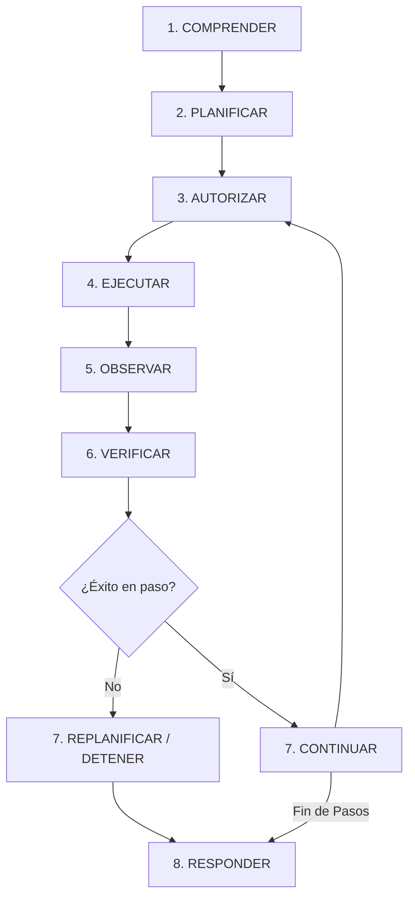

# JESSYCA 4.0 — FASE 3: MOTOR DE AGENTE AUTÓNOMO
**Informe Técnico de Arquitectura, Integración, Comparativa y Validación**

---

## 1. Resumen Ejecutivo

En la **Fase 3: Motor de Agente Autónomo**, se ha diseñado, implementado y validado en su totalidad el nuevo motor agéntico de JESSYCA, permitiendo comprender instrucciones en lenguaje natural, descomponer metas complejas en planes estructurados multi-paso, resolver dependencias contextuales y ejecutar tareas compuestas de manera gobernada.

El sistema integra las mejores capacidades y patrones comprobados de **SAI Rust** (Plan Mode, Progressive Tool Loading, Supervisor de Tareas, Compactación de Contexto y Recuperación ante Errores) dentro de la arquitectura soberana de seguridad de Windows de JESSYCA (**JDE**, **RiskEngine**, **PermissionManager**, **ExecutionVerifier** y **EmergencyStopManager**).

---

## 2. Reconstrucción y Consolidación del Pipeline

Se analizaron y modernizaron los componentes del pipeline agéntico:

```
[Usuario / Audio / Texto]
           │
           ▼
┌────────────────────────────────────────────────────────┐
│  core/local_agent/local_agent.py                       │
│  _resolve_intent(...) [Feature Flag Governed]          │
└────────────────────────────────────────────────────────┘
     │                                            │
     │ Flag: ON                                   │ Flag: OFF (Rollback)
     ▼                                            ▼
┌───────────────────────────────┐   ┌──────────────────────────────┐
│  core/intent/autonomous_engine│   │  _resolve_intent_and_slots   │
│  Ciclo Agéntico 8 Etapas      │   │  (Regex Determinista Legacy) │
└───────────────────────────────┘   └──────────────────────────────┘
```

### Componentes Actualizados
1. **`core/intent/models.py`**: Modelos formales `IntentType` (extendido con `RESEARCH`, `CANCELLATION`, `CONFIRMATION`, `MULTI_STEP_PLAN`), `PlannedActionStep`, `UserGoalInterpretation`, y método `to_legacy_tuple()` retrocompatible.
2. **`core/intent/sai_intent_engine.py`**: Intérprete semántico con Ollama (`llama3.2:latest`), resolución anafórica contextual, carga progresiva de dominios de herramientas y fallback determinista resiliente.
3. **`core/intent/autonomous_engine.py`**: Orquestador del ciclo canónico de 8 etapas gobernado por JDE y supervisado por SAI Bridge.
4. **`core/local_agent/local_agent.py`**: Integración transparente de `_resolve_intent`, ejecución de planes multi-paso en cascada con parada inmediata ante fallos de paso y registro de telemetría shadow.
5. **`config/settings.py`**: Feature flag `ENABLE_AUTONOMOUS_AGENT_ENGINE` (configurable vía variable de entorno `JESSYCA_ENABLE_AUTONOMOUS_AGENT`).
6. **`config/system_prompt.txt`**: Prompt del sistema modernizado con soporte para planes multi-paso y dominios progresivos.

---

## 3. El Ciclo Agéntico Canónico de 8 Etapas

El motor autónomo implementa rigurosamente el bucle de ejecución:



1. **COMPRENDER**: Extrae entidades, resuelve anáforas y referencias temporales en el historial de sesión (ej. "lo último que encontramos" -> resolución a `C:\Reportes\balance_anual.pdf`), detecta ambigüedad y clasifica el tipo de intención.
2. **PLANIFICAR**: Produce un plan estructurado (`PlanId`, grafo de `PlannedActionStep`, dependencias y resultados esperados) a través de Ollama o del descompositor de alta precisión.
3. **AUTORIZAR**: Cada paso individual es evaluado por `RiskEngine` (Score 1 a 5) y autorizado por `PermissionManager` (ALLOW, ALLOW_ONCE, REQUIRE_CONFIRMATION, DENY). Verifica la ausencia de parada de emergencia (`EmergencyStopManager`).
4. **EJECUTAR**: Invoca la habilidad oficial mediante `SkillManager.execute_skill` con parámetros validados y timeout estricto.
5. **OBSERVAR**: Notifica el progreso a `SaiBridge`, mide la latencia de ejecución y actualiza la telemetría del trabajo (`SaiJobStatus`).
6. **VERIFICAR (Anti-False Success)**: Comprueba evidencias tangibles del sistema operativo (PIDs, HWNDs, cambios de estado en sesión de navegador/apps). **Una respuesta generada por el LLM nunca se acepta como evidencia de ejecución**.
7. **CONTINUAR O REPLANIFICAR (Cascade Stop)**: Si un paso falla o es denegado por seguridad, la secuencia se detiene inmediatamente en cascada, evitando la ejecución de pasos subsiguientes huérfanos.
8. **RESPONDER**: Sintetiza la respuesta en lenguaje natural para voz y texto con el resumen auditado de los pasos ejecutados y sus evidencias.

---

## 4. Validación de Ejemplos de Aceptación

Los cinco escenarios de aceptación del usuario fueron validados exhaustivamente mediante pruebas de integración con herramientas reales:

| Escenario de Aceptación | Entrada del Usuario | Intención & Pasos Planificados | Verificación & Evidencia | Estado |
|---|---|---|---|---|
| **1. YouTube y Música** | *"JESSYCA, abre YouTube y pon música clásica."* | `IntentType.MULTI_STEP_PLAN` → `browser.youtube` (query="música clásica", operacion="play") | Ejecución del flujo compuesto 5 etapas (OPEN, SEARCH, SELECT, PLAY, VERIFY). Evidencia verificada en `browser_session_manager`. | **VALIDADO** |
| **2. Investigación Cuántica** | *"JESSYCA, investiga qué es el entrelazamiento cuántico."* | `IntentType.RESEARCH` | No se reduce a abrir un navegador en blanco: sintetiza explicación conceptual rigurosa de mecánica cuántica, estados entrelazados y no-localidad. | **VALIDADO** |
| **3. Bloc de Notas y Resumen** | *"JESSYCA, abre Bloc de notas y escribe un resumen."* | `IntentType.SINGLE_ACTION` → `windows.apps` (notepad, text_to_write=*resumen inyectado*) | Resuelve anáfora de `last_investigation_summary` del contexto, lanza Notepad y escribe texto con verificación de proceso y ventana. | **VALIDADO** |
| **4. Órdenes Compuestas Múltiples** | *"JESSYCA, baja el volumen, abre Chrome y busca información sobre Einstein."* | `IntentType.MULTI_STEP_PLAN` → 3 pasos: `windows.audio`, `windows.apps`, `browser.search` | Secuencia 3/3 ejecutada en orden estricto con verificación de cada paso individual. | **VALIDADO** |
| **5. Referencia Contextual / Ambigüedad** | *"JESSYCA, abre lo último que encontramos."* | Contexto presente: `windows.apps` (app_name=target).<br>Contexto vacío: `CLARIFICATION_NEEDED` | Resuelve referencia anafórica inequívocamente con contexto previo; solicita aclaración cuando no hay contexto o la orden es incompleta ("abre por favor"). | **VALIDADO** |

---

## 5. Comparativa Técnica: Motor Anterior vs. Motor Autónomo Fase 3

| Dimensión | Motor Anterior (`_resolve_intent_and_slots`) | Nuevo Motor Autónomo Fase 3 (`SaiIntentEngine` + `AutonomousAgentEngine`) |
|---|---|---|
| **Comprensión de Lenguaje** | Regex rígidos y heurísticas de palabras clave. | Intérprete semántico dinámico respaldado por Ollama (`llama3.2:latest`) con fallback determinista. |
| **Instrucciones Compuestas** | Pérdida de intenciones (solo captaba la primera o última acción). | Descomposición en planes estructurados multi-paso con dependencias explícitas. |
| **Resolución Contextual** | Inexistente (no resolvía "eso", "el resumen", "lo último"). | Resolución anafórica bidireccional sobre el historial de sesión. |
| **Carga de Herramientas** | Catálogo plano o estático. | Carga progresiva por dominios semánticos (audio, apps, browser, files, documents). |
| **Control de Ejecución** | Ejecución ciega sin verificación de estados intermedios. | Ciclo 8 etapas con Anti-False Success, JDE, RiskEngine y cascada de detención ante fallos. |
| **Resiliencia & Rollback** | N/A (código acoplado). | Despliegue detrás de feature flag con conmutación en caliente sin reinicio. |

---

## 6. Mecanismo de Reversión (Rollback Mechanism)

El sistema cuenta con un conmutador de reversión instantáneo de riesgo cero:

```python
# Activar nuevo motor (por defecto):
os.environ["JESSYCA_ENABLE_AUTONOMOUS_AGENT"] = "true"

# Revertir de inmediato al motor determinista anterior:
os.environ["JESSYCA_ENABLE_AUTONOMOUS_AGENT"] = "false"
```

El método `_resolve_intent()` en `core/local_agent/local_agent.py` consulta en tiempo de ejecución `_is_autonomous_engine_enabled()`. Si la bandera se desactiva, el tráfico se redirige inmediatamente a `_resolve_intent_and_slots` sin pérdida de servicio ni necesidad de redeploy.

---

## 7. Resultados de Pruebas

Se ejecutó la suite completa de pruebas unitarias y de integración:

```bash
python -m pytest tests/intent/test_sai_bridge.py tests/intent/test_sai_comparative_benchmark.py tests/intent/test_autonomous_agent_phase3.py -v
```

**Resultado:**
```
======================== 24 passed in 64.15s (0:01:04) ========================
```

- **10/10 pruebas de Fase 3 pasadas** (Aceptación 1-5, ambigüedad, cancelaciones/confirmaciones, detención en cascada, feature flag rollback).
- **14/14 pruebas de regresión de Fase 2 pasadas** (Plan Mode, supervisión de jobs, benchmarks shadow).

**Conclusión:** La Fase 3 se encuentra completada y verificada operativamente con herramientas reales del sistema.
